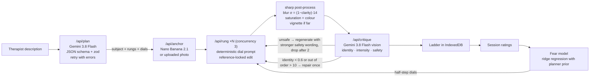

# Fear Ladder

**Exposure therapy, one rung at a time.** Fear Ladder turns a therapist's exposure hierarchy into a personalized ladder of AI-generated images: the same feared subject on every rung at gently rising intensity. The ladder adapts as the patient climbs.


- **Live demo:** https://fear-ladder-beta.vercel.app (demo ladders work with no API key)
- **Built for:** [Banana Hacks 2026](https://bananahacks.tech): generative AI and image creation

> Designed for use with a licensed therapist. Not a medical device. Not for emergencies.
> If you are in crisis, call or text 988 (US and Canada) or your local emergency number.

## What it does

1. **Describe.** The therapist writes the patient's fear in plain words, for example "big hairy spiders, worst when they move toward me".
2. **Plan.** An LLM planner turns the description into 8 to 10 rungs with evenly spaced target SUDS (5–15 at the bottom, 85–95 at the top, no gap above 15). It expresses each rung as eight visual **dials**: realism, proximity, size, contact, count, clarity, colour and motion.
3. **Render.** One identity anchor image locks the subject. Every rung is a reference-locked edit of that same subject, built from a deterministic prompt. **sharp** then applies exact blur, saturation and vignette.
4. **Check.** A vision critic scores each rung for identity match, estimated intensity and safety, and repairs rungs that fail. Unsafe drafts are never shown.
5. **Adapt.** In session, the patient predicts, looks (hold-to-view), rates distress and reflects.
   - Stuck? A **half-step** rung is generated live and slides in between two rungs.
   - Mastered? **Variations** show a new individual or setting at the same intensity.
   - A per-patient ridge regression learns which dials drive this patient's fear (the **fear fingerprint**).
6. **Report.** SUDS curves, peak vs end, expectancy change, looking time and releases, notes on what the patient learned, and the fingerprint radar. Print-ready.

## Features

| Screen | Highlights |
|---|---|
| Landing `/` | Demo spider ladder strip (blurred until hover or tap), evidence with sources, how it works, strategy-to-feature table, safety |
| Builder `/new` | Phobia presets (Spiders, Dogs, Snakes, Needles, Birds, Bees and wasps, Heights beta, Other), alias-only, worst and okay fields, reference photo upload, rung count, start-with-the-word, session settings |
| Ladder `/ladder/[id]` | Live-filling ladder with a "developing photograph" animation, tap-to-reveal, critic badges, rung drawer with dial sliders, regenerate, variations by context, delete, export, **Under the hood** Pipeline Inspector |
| Session `/ladder/[id]/session` | Dark, quiet patient view; prediction and likelihood; hold-to-view (press or hold Space) with fade-to-blur on release; SUDS slider with a 30 s pulse; rotating notice prompts; breathing pause (4 in, 6 out); reflection; next-step card; live half-steps; summary |
| Report `/ladder/[id]/report` | SUDS small multiples, peak vs end, expectancy, looking time and releases, fear fingerprint, learned notes, full table, print stylesheet |

## Pipeline



Every model call runs in its own server route (`runtime = "nodejs"`, `maxDuration = 60`), with 3-attempt backoff on 429 and 5xx errors and a 55 s budget. The browser orchestrates the calls, so rungs appear one by one. Each attempt is recorded (prompt, params, latency, critic JSON) and shown in the Pipeline Inspector.

## Setup

```bash
npm install
cp .env.example .env.local      # then paste your own GEMINI_API_KEY into .env.local
npm run dev                      # http://localhost:3000
```

| Env var | Default | Purpose |
|---|---|---|
| `GEMINI_API_KEY` | — | Server-side only. Without it the app runs in demo mode. |
| `IMAGE_MODEL` | `gemini-nano-banana-2.1` | Image generation and editing |
| `TEXT_MODEL` | `gemini-3.8-flash` | Planner and variation planner |
| `CRITIC_MODEL` | `gemini-3.8-flash` | Vision critic |
| `CRITIC_FALLBACK_MODEL` | `gemini-3.5-flash-lite` | Critic when rate limited |
| `MAX_LIVE_LADDERS_PER_DAY` | `30` | Spend guard (plus 3 ladders per IP per hour) |

### Seed the demo ladders

The seed script drives **the same pipeline** over HTTP (plan → anchor → rungs → critic) and writes `public/demo/{spiders,dogs,needles}/` (`ladder.json`, `anchor.jpg`, `rung-N.jpg`).

```bash
npm run build && npm start &          # with GEMINI_API_KEY in .env.local
npm run seed                          # all three, or: npm run seed -- spiders
# or seed against a deployment whose env holds the key (the key never touches your machine):
SEED_BASE_URL=https://your-app.vercel.app npm run seed
```

### Checks

```bash
npm run typecheck && npm run lint && npm run build
npm run test:e2e         # Playwright golden path on the demo spider ladder
npm run screenshots      # docs/screenshots at 1440px and 390px (needs a running server)
```

### Deploy (Vercel)

1. Import the repo in Vercel (framework: Next.js). The `sharp` routes already run on the Node runtime with `maxDuration = 60`.
2. Add `GEMINI_API_KEY` (and optionally `MAX_LIVE_LADDERS_PER_DAY`) under **Project → Settings → Environment Variables**, then redeploy.
3. Without the key, `/api/health` reports `live: false`, and the app offers the demo ladders everywhere live generation would be used.

## Safety, privacy and ethics

- **Specific phobias only.** The planner refuses trauma or PTSD imagery, self-harm, eating-related content, sexual content and real people, and explains why in one calm sentence.
- **Content rules enforced three times:** in the planner prompt, the rung prompt and the vision critic. No blood, injury, gore, aggression, attacks, death or children in danger. Unsafe outputs are never shown. If two drafts of a rung fail, the rung is dropped and the therapist is told.
- **Clinician in the loop.** The builder, dials and progress settings are for the therapist. Nothing auto-advances.
- **Consent by design.** Images start blurred. The patient chooses when to look, and Pause is always one tap away. Hold-to-view works as a "dead man's brake", and every release is counted.
- **Needle ladders** open with: "Sit down before you start. If you feel faint, use the applied-tension technique your therapist taught you."
- **Privacy.** No accounts; patients are identified by alias only. Ladders, images and sessions live in the browser's IndexedDB. The server stores nothing and logs no prompts or images. "Delete all local data" is in the footer.
- **Transparency.** Every generated image carries Google's invisible SynthID watermark, and every rung image shows an "AI-generated" label.

## Built on the science

| Inhibitory-learning strategy ([Craske et al., 2014](https://doi.org/10.1016/j.brat.2014.04.006); [OptEx Nexus](https://doi.org/10.1016/j.brat.2022.104069)) | Feature |
|---|---|
| Expectancy violation | Prediction + likelihood before each exposure; "did it happen?" + surprise after |
| Attention to the feared stimulus | 2–3 notice prompts per rung during exposure |
| Removal of safety signals | Hold-to-view → steady view; releases reported as avoidance |
| Stimulus variability | "New variation": different individual, same intensity |
| Multiple contexts | Variations by setting (kitchen, garden, bathroom…) |
| Affect labeling | Feeling chips after exposure |
| Mental rehearsal | "What did you learn?" collected in the report |

Progress modes: **expectancy** (default: climb when the predicted outcome didn't happen) and **habituation** (climb when SUDS falls to half its peak or to 30 or below; see the [Therapist Aid exposure tracking log](https://www.therapistaid.com/therapy-worksheet/exposure-tracking-log)). The hierarchy rules follow the [Therapist Aid guide](https://www.therapistaid.com/therapy-guide/creating-an-exposure-hierarchy-guide).

## Evidence

- An estimated 9.1% of U.S. adults had a specific phobia in the past year, and 12.5% will at some point in their lives ([NIMH](https://www.nimh.nih.gov/health/statistics/specific-phobia)).
- Only about 11% of people with a specific phobia receive minimally adequate treatment in a year ([NCS-R data, NIMH](https://www.nimh.nih.gov/sites/default/files/documents/health/statistics/prevalence/file_12.pdf)).
- Exposure is highly effective but underused; as few as 7% of therapists and patients report providing or receiving it ([Kemp et al., 2023](https://pmc.ncbi.nlm.nih.gov/articles/PMC9975163/)).
- An 8-stage online hierarchy of spider images reduced fear ([Matthews, Naran & Kirkby, 2015](https://doi.org/10.1016/j.jbtep.2014.12.003)). FEARDROP's design put user agency first with a "dead man's brake" ([Kirkby, Matthews & Scanlan](https://doi.org/10.3233/978-1-60750-561-7-73)).
- In a 66-person randomized trial, six 30-minute sessions with the Phobys AR app reduced fear of real spiders ([University of Basel](https://www.unibas.ch/en/News-Events/News/Uni-Research/Augmented-reality-helps-tackle-fear-of-spiders.html); [Zimmer et al., 2021](https://doi.org/10.1016/j.janxdis.2021.102442)).

## AI tools used

- **Gemini API (Google):**
  - `gemini-nano-banana-2.1` (Nano Banana 2.1) for image generation and reference-locked editing.
  - `gemini-3.8-flash` for the planner, the variation planner and the vision critic.
  - `gemini-3.5-flash-lite` as the critic fallback.
  - All are called through the `@google/genai` Interactions API.
- **Claude Code (Anthropic)** wrote this codebase with the author during the hackathon.

## Credits

| Library | Use |
|---|---|
| [Next.js](https://nextjs.org) 16, [React](https://react.dev) 19, [TypeScript](https://www.typescriptlang.org) | App framework |
| [@google/genai](https://www.npmjs.com/package/@google/genai) | Gemini API SDK |
| [zod](https://zod.dev) | Validates every model response and request |
| [sharp](https://sharp.pixelplumbing.com) | Deterministic image post-processing |
| [Tailwind CSS](https://tailwindcss.com) 4 | Styling |
| [Motion](https://motion.dev) | Animation (honours reduced motion) |
| [Recharts](https://recharts.org) | Report and inspector charts |
| [Lucide](https://lucide.dev) | Icons |
| [idb-keyval](https://github.com/jakearchibald/idb-keyval) | IndexedDB storage |
| [Playwright](https://playwright.dev), [tsx](https://tsx.is), [ESLint](https://eslint.org) | Testing, scripts, linting |
| [Fraunces](https://fonts.google.com/specimen/Fraunces), [Instrument Sans](https://fonts.google.com/specimen/Instrument+Sans), [IBM Plex Mono](https://fonts.google.com/specimen/IBM+Plex+Mono) | Type, via `next/font/google` |

## License

MIT for the code. Generated images are produced by Google's models and carry SynthID.
