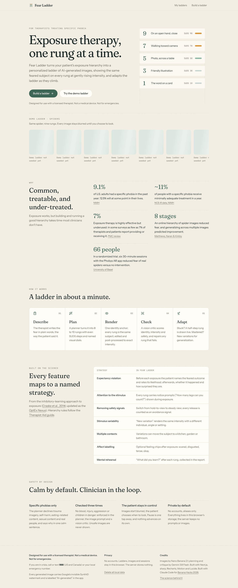
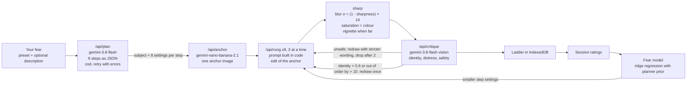
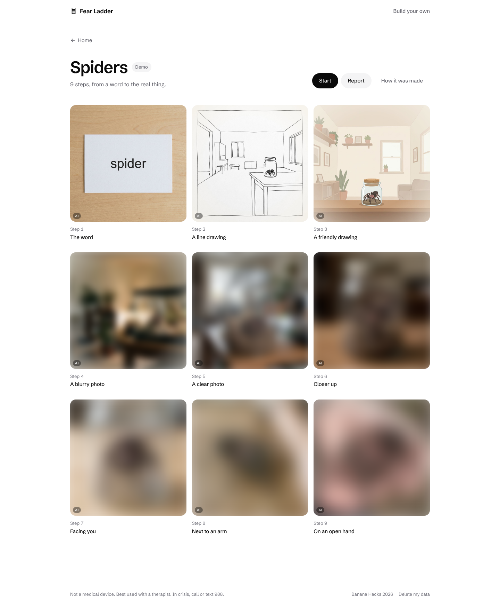
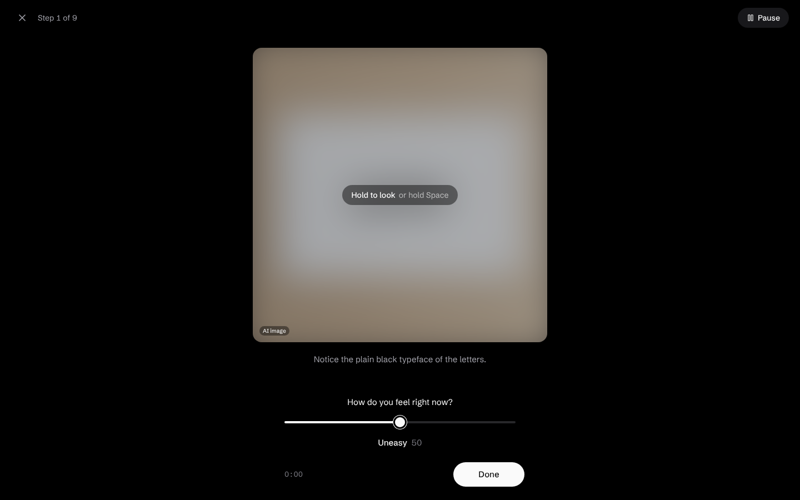
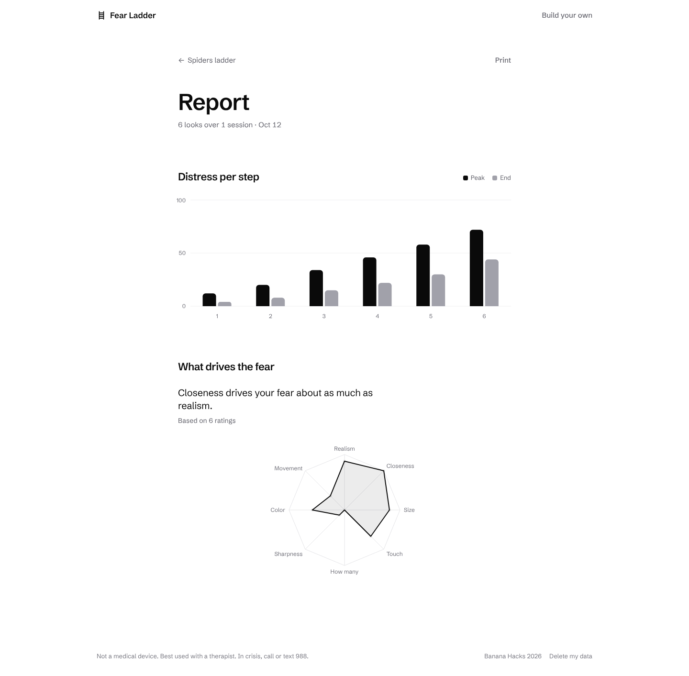

# Fear Ladder

Pick a phobia and Fear Ladder draws the same subject nine ways, from the word on a card up to the real thing, like a tarantula sitting on an open palm. You look at one step at a time and move up when you're ready.



- **Try it:** https://fear-ladder-beta.vercel.app
- **Commercial (48s, voiceover and music):** [`docs/fear-ladder-commercial.mp4`](docs/fear-ladder-commercial.mp4)
- **Silent promo reel:** [`docs/fear-ladder-reel.mp4`](docs/fear-ladder-reel.mp4)
- **Built for:** [Banana Hacks 2026](https://www.bananahacks.tech/), Oct 9 to 12, online

> Fear Ladder is not a medical device and isn't meant for emergencies. If you're in crisis, call or text 988 (US and Canada) or your local emergency number.

## What it does

The home page has two buttons. **Try the demo** opens a ladder that's already built, and **Build your own** asks what you're afraid of (Spiders, Dogs, Snakes, Needles, Birds, Heights or Something else) and lets you describe it in a few words. Press **Build my ladder** and the nine images fill in one by one over about a minute and a half.

The ladder is a grid of the nine steps, blurred until you choose to look. Tap one to see it big. From there you can redraw it, or ask for a new variation that keeps the same intensity but changes the animal or the setting. **How it was made** opens the pipeline inspector.

A session takes you up the ladder. Before each step you guess how anxious you'll feel. To look, you press and hold (or hold Space), and the image blurs again the moment you let go. After that you rate how you feel and say whether it was easier, the same or worse than you expected. If your distress stays high, the app draws a smaller step on the spot and slides it in between this step and the next. Pause opens a breathing screen if you need a minute.

At the end, the report charts peak and end distress for each step, plus a radar of what drives your fear, from a small model trained on your own ratings.

## How it works

All the AI runs on the Gemini API through the `@google/genai` Interactions API.

The planner (`gemini-3.8-flash`) writes the nine steps as JSON. zod validates it, and if it fails, the planner gets one retry with the validation errors attached. Each step is a short scene plus eight visual settings: realism, distance, size, contact, count, sharpness, colour and motion.

Next the app makes one anchor image that locks in the subject, so the spider on step 3 is the same spider on step 9. Every step is an edit of that anchor by `gemini-nano-banana-2.1`, with a prompt built in code from the step's settings. Then sharp applies the exact blur, saturation and vignette for that step, so a gentle step stays gentle even if the model draws it sharper than planned.

A vision critic (`gemini-3.8-flash`, falling back to `gemini-3.5-flash-lite`) scores each image for identity match, estimated distress and safety. Unsafe drafts are redrawn with stricter wording and never shown. A step that drifts off the subject or lands out of order gets one redraw.



Each model call gets its own serverless route with 3 retries, backoff and a 55 second budget. The browser runs three of those calls at a time, and the ladder fills in as each step finishes.

The smaller step comes from a ridge regression fit to one person. It maps the eight settings to that person's peak distress and starts from a prior that reproduces the planner's targets. Once it has 3 ratings, it picks the in-between settings it predicts will land halfway between the two steps.

### Results on the demo ladders

The three seeded demos (spiders, dogs and needles) each came out with all 9 steps in about 90 to 100 seconds. Every step of the spider ladder shows the same Chilean rose tarantula. The critic's distress estimates landed within 10 points of the target on most steps, though it tends to rate the top steps lower than planned (for spiders, 92 planned and 78 estimated). A live variation came out at the same estimated distress as its parent (52 vs 52).

## Screenshots

| Ladder | Looking at a step | Report |
|---|---|---|
|  |  |  |

The rest are in [`docs/screenshots/`](docs/screenshots).

## Run it locally

```bash
npm install
cp .env.example .env.local   # then add your GEMINI_API_KEY
npm run dev                  # http://localhost:3000
```

The key is only read on the server. Without one, the app runs on the demo ladders. `.env.example` also lists optional model overrides and `MAX_LIVE_LADDERS_PER_DAY` (default 30), a cap on live builds.

### Seed the demo ladders

The seed script calls the same API routes the app uses and writes the results to `public/demo/{spiders,dogs,needles}/`.

```bash
npm run build && npm start &   # with GEMINI_API_KEY in .env.local
npm run seed                   # all three, or: npm run seed -- spiders

# or point it at a deployment that already has the key
SEED_BASE_URL=https://your-app.vercel.app npm run seed
```

### Checks

```bash
npm run typecheck
npm run lint
npm run build
npm run test:e2e      # Playwright, end to end
npm run screenshots   # regenerates docs/screenshots (needs a running server)
```

### Deploy on Vercel

Import the repo in Vercel as a Next.js project. Add `GEMINI_API_KEY` under Project Settings, then Environment Variables, and redeploy. The routes that use sharp already run on the Node runtime with `maxDuration = 60`. If the key is missing, `/api/health` reports `live: false` and the app sticks to the demo ladders.

## Safety and privacy

Fear Ladder only handles specific phobias. The planner turns down requests about trauma, self-harm, eating, sexual content or real people. The planner, the image prompt and the critic all rule out blood, injury and aggression, and an unsafe image never reaches the screen. Every image starts blurred and nothing moves forward on its own. Needle sessions open with a tip about fainting.

There are no accounts. Your ladders, images and ratings stay in your browser in IndexedDB, and the server stores nothing.

## Why build this

Specific phobias are common, and most people who have one don't get adequate treatment. NIMH estimates that [9.1% of U.S. adults](https://www.nimh.nih.gov/health/statistics/specific-phobia) had one in the past year, and only about [11% of them get minimally adequate treatment](https://www.nimh.nih.gov/sites/default/files/documents/health/statistics/prevalence/file_12.pdf). Exposure is rarely used either, and as few as [7% of therapists and patients](https://pmc.ncbi.nlm.nih.gov/articles/PMC9975163/) report using it.

[One study](https://doi.org/10.1016/j.jbtep.2014.12.003) found that an 8-stage online hierarchy of spider images reduced fear. Fear Ladder builds that kind of hierarchy for the phobia you pick in about a minute and a half. In each session you predict how anxious you'll feel before you look and compare it with how you actually felt, which follows the [inhibitory-learning approach](https://doi.org/10.1016/j.brat.2014.04.006).

## AI tools used

- **Gemini API (Google)** through `@google/genai`. `gemini-3.8-flash` plans the ladder and the variations and runs the vision critic. `gemini-nano-banana-2.1` draws the anchor and edits every step. `gemini-3.5-flash-lite` is the critic's fallback.
- **Gemini TTS and Lyria (Google)** made the commercial's soundtrack. `gemini-3.8-flash-tts` (voice "Despina") reads the voiceover, and `lyria-3.5` composed the music. See `video/make-audio.mjs`.
- **Claude Code (Anthropic)** wrote the code with the author during the hackathon.

## Credits

| Library or model | Used for |
|---|---|
| [Next.js](https://nextjs.org) 16, [React](https://react.dev) 19, [TypeScript](https://www.typescriptlang.org) | App framework |
| [Tailwind CSS](https://tailwindcss.com) 4 | Styling |
| [@google/genai](https://www.npmjs.com/package/@google/genai) | Gemini API SDK (Interactions API) |
| `gemini-3.8-flash` | Planner, variation planner, vision critic |
| `gemini-nano-banana-2.1` (Nano Banana 2.1) | Anchor image and step edits |
| `gemini-3.5-flash-lite` | Critic fallback |
| [zod](https://zod.dev) | Validates model output and requests |
| [sharp](https://sharp.pixelplumbing.com) | Exact blur, saturation and vignette |
| [Motion](https://motion.dev) | Animation |
| [Recharts](https://recharts.org) | Report charts |
| [Lucide](https://lucide.dev) (`lucide-react`) | Icons |
| [idb-keyval](https://github.com/jakearchibald/idb-keyval) | IndexedDB storage |
| [server-only](https://www.npmjs.com/package/server-only) | Keeps the API key code off the client |
| [Playwright](https://playwright.dev) | End-to-end tests |
| [tsx](https://tsx.is) | Seed and screenshot scripts |
| [ESLint](https://eslint.org) | Linting |
| [Schibsted Grotesk](https://fonts.google.com/specimen/Schibsted+Grotesk) | Typeface, via `next/font/google` |
